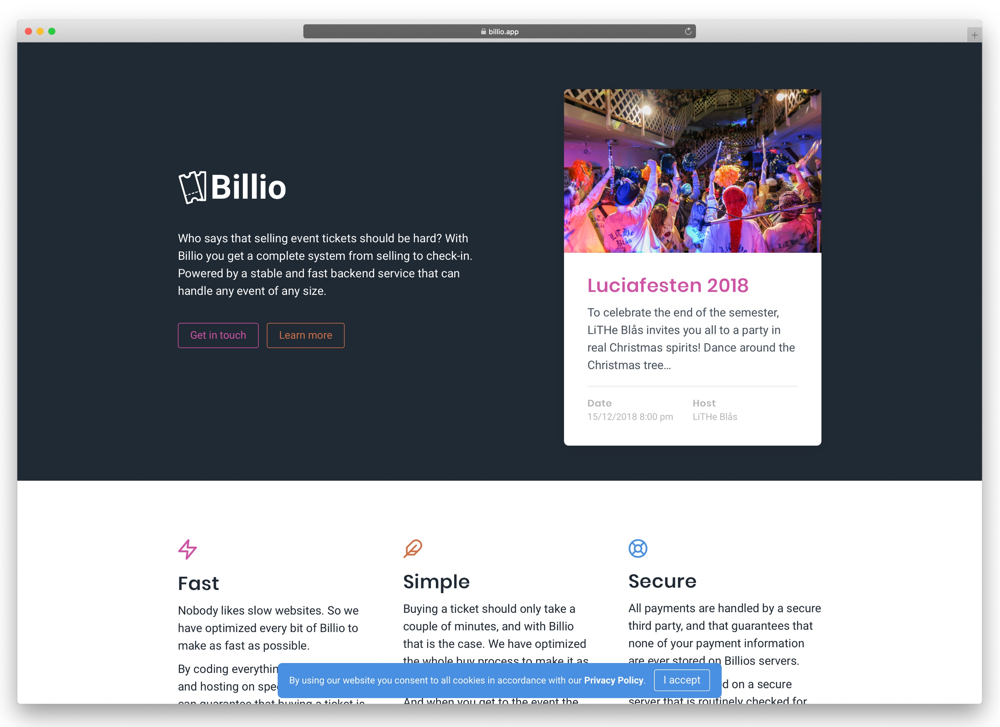

Billio
=======

Billio is a simple, fast, and nice looking event system. It has been used for [LiTHe Blås](https://litheblas.org/) Luciafest 2018 and 2019.

Introduction
------------

Billio is a web based event system. It provides event managers a system to sell tickets in a simple and fast way. It has a REST API for clients to connect to.

The main project is a [Laravel](https://laravel.com/) application. In addition to the main project there is [a check in app](https://github.com/WheresMarco/billio-checkin) that is build in React Native. That app is required to get tickets scanned.

Requirements
------------

- [The requirements for Laravel](https://laravel.com/docs/master/installation).
- An Stripe account (to process payments).
- An Algolia account (to handle check in, searches tickets table).
- For student ID check you need API-keys from the local student unions.

Installation
-------------

Next clone the repository and install the application dependencies

    git clone https://github.com/wheresmarco/billio.git
    cd billio
    composer install
    yarn install
    yarn run dev

If you encounter any errors after running `composer install` there is a problem installing one of the dependencies. You must find out how to get this dependency installed on your platform.

**Configure**

Billio uses environment variables for configuration. Billio will run without most of these, but various features and functionality will be turned off.

Rename [.env.example](.env.example) to `.env` and customize it with your settings.

**Setup the database**

    php artisan migrate

